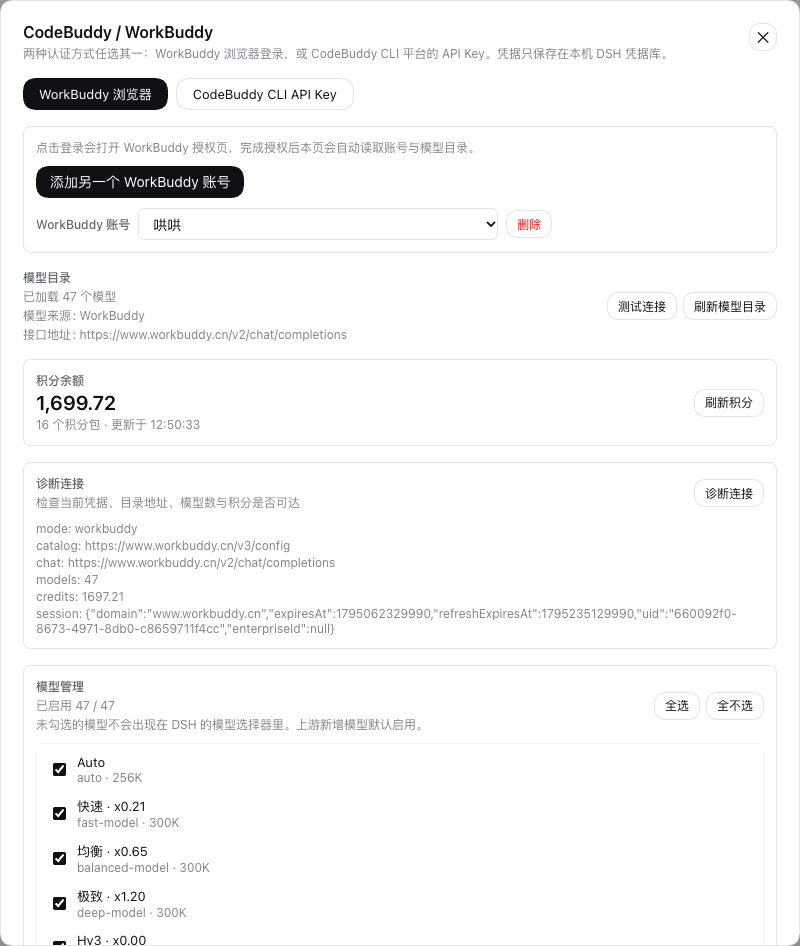

# dsh-plugin-workbuddy-lite

> WorkBuddy 浏览器登录 + CodeBuddy CLI API Key 双认证的 DeepSeek Harness provider。



把 WorkBuddy / CodeBuddy 的模型接进 DSH：打开输入框下方、与上下文进度条同一行的 **CodeBuddy** 入口（或 **设置 → CodeBuddy**），选一种认证方式——用浏览器登录 WorkBuddy，或粘贴 CodeBuddy CLI 平台签发的 API Key。插件会在 `ctx.llm` 上注册 `codebuddy` provider，模型目录、聊天流、工具调用、推理档位与图片输入都走 CodeBuddy 官方协议。

本项目是一个**第三方适配器**，不属于 WorkBuddy、CodeBuddy 或 DeepSeek Harness 官方项目。

GitHub：<https://github.com/zhouxf08/dsh-plugin-workbuddy-lite>

## 功能

- **输入框下方入口**：在输入框下方的统计/上下文进度条同一行常驻 **CodeBuddy** 按钮，点开就是配置弹层
- **两种认证方式，随时切换**
  - **WorkBuddy 浏览器**：点击登录 → 打开 WorkBuddy 授权页 → 授权完成后自动落库账号与模型目录；
  - **CodeBuddy CLI API Key**：粘贴平台 API Key，支持中国版 / 海外版 / iOA / 自定义服务地址。
- **多账号**：WorkBuddy 账号与 API Key 都可以保存多个并切换。
- **实时代理模型目录**：读取 `/v3/config`，保留每个模型的上下文窗口、输出上限、图片能力与思考档位。
- **OpenAI 兼容流式聊天**：SSE 解析、工具调用增量、推理内容、usage 统计。
- **图片输入**：通过 DSH 的 attachment seam 读取并按官方压缩档发送。
- **无需重启**：登录、切换账号、保存 API Key 后通过 `llm/adapters-updated` 即时刷新模型选择器（Web 端）。
- **凭据安全**：Key / token 只写入 `ctx.credentials`；设置页只显示掩码，HTTP 路由只接受本机同源 POST。

## 环境要求

- DSH `0.2.1-rc.2`（`web` / `desktop` profile，带浏览器载体）
- Node.js `>= 22.19.0`

## 安装

先把插件打成 tarball，再把 tarball 装进 profile：

```sh
cd dsh-plugin-workbuddy-lite
npm pack
./install.sh
```

`install.sh` 会优先用 PATH 里的 `dsh`；没有时自动改用 `DeepSeek Harness.app`
自带的 Electron 以 Node 模式执行同一个 CLI。也可以手动执行：

```sh
dsh plugin --profile web add ./dsh-plugin-workbuddy-lite-0.1.5.tgz
```

> **不要直接 `dsh plugin add` 本目录**：本地目录会以 pnpm `link:` 方式安装，插件运行时
> 解析不到 DSH 宿主提供的 `@deepseek-ai/*` peer 依赖，Loader 会报
> `failed to import`。tarball 安装会把包内容复制进 profile，宿主依赖按正常方式解析。

装完完全退出 DSH 再打开（macOS 用 `⌘Q`，不是关窗口）。侧边栏 **设置 → CodeBuddy**
出现认证页即安装成功。

### 桌面端（DSH.app）

桌面 profile 由 DSH.app 独占管理，不能直接用 `dsh plugin --profile desktop` 修改。
请在应用里操作：

1. 先在 **插件** 页卸载或禁用旧包 `dsh-plugin-workbuddy-codebuddy`；
2. 点 **添加插件**，在「包名或地址」里填 tarball 的**绝对路径**，例如：
   `/Users/you/dsh-plugin-workbuddy-lite/dsh-plugin-workbuddy-lite-0.1.5.tgz`
3. 安装完成后如果出现「立即启用」，点一次；没有的话重启 DSH.app；
4. 打开 **账号菜单 → 设置 → CodeBuddy** 测试。

> 旧包和新包都注册 `codebuddy` provider 路由，不能同时启用。新包沿用
> `CODEBUDDY_WORKBUDDY_SESSIONS` / `CODEBUDDY_API_KEYS` 两个凭据引用，所以已保存的
> 账号和 API Key 通常可以直接沿用。

如果已经装了别的 CodeBuddy provider 插件（例如 `@tnnevol/dsh-codebuddy`、
`@mybna134/dsh-llm-codebuddy`，或更名前的 `dsh-plugin-workbuddy-codebuddy`），
请先移除或禁用，否则两个插件会争用同一个 `codebuddy` provider 路由。

> 本插件是 `dsh-plugin-workbuddy-codebuddy` 的更名版本（新包名
> `dsh-plugin-workbuddy-lite`）。从旧包升级时，请先卸载旧包，再安装本包。

## 使用

### 打开配置

输入框下方、与上下文进度条同一行的 **CodeBuddy** 按钮，或 **账号菜单 → 设置 → CodeBuddy**，二选一。

### 方式一：WorkBuddy 浏览器登录

1. 打开 **CodeBuddy** 配置弹层；
2. 选择 **WorkBuddy 浏览器**；
3. 点 **登录 WorkBuddy**，浏览器会打开 WorkBuddy 授权页；
4. 完成授权后回到 DSH，页面会自动显示账号与模型数量。

> 登录 URL 也会以链接形式显示在按钮旁边，弹窗被浏览器拦截时可以手动点击。

### 方式二：CodeBuddy CLI API Key

1. 打开 **CodeBuddy** 配置弹层；
2. 选择 **CodeBuddy CLI API Key**；
3. 选择服务环境：
   - 中国版：<https://copilot.tencent.com/profile/>
   - 海外版：<https://www.codebuddy.ai/profile/keys>
   - iOA 企业版：在 iOA 平台获取 Key
   - 自定义：填写企业自建服务地址
4. 粘贴 Key，可填备注名，点 **保存并使用**。
5. 保存前会先测试模型目录；失败时错误信息会带上实际请求地址，点 **测试连接** 可随时复测。

> 自定义服务地址只填**服务根**，例如 `https://copilot.tencent.com`。插件会自动去掉误填的
> `/profile/keys`、`/v2/chat/completions` 等后缀；OpenAI 兼容的 `/v1` 地址会被拒绝。

保存时插件会先用该 Key 拉一次模型目录；拉不到模型会拒绝保存并给出错误，不会把无效 Key 落库。

也可以不保存、直接用环境变量：

```sh
export CODEBUDDY_API_KEY="your-api-key"
export CODEBUDDY_INTERNET_ENVIRONMENT=internal   # 中国版；海外版不设置
```

环境变量 Key 会出现在设置页的 API Key 列表里（标记为环境变量，只显示掩码）。

## 模型选择

认证成功后，模型出现在 DSH 的模型选择器里，provider 名为 **CodeBuddy**。选择器和设置页里的模型名带官方倍率后缀（例如 `GLM-5.3 · x0.79`），请求实际使用的仍是模型 id。

## 数据与安全

| 数据 | 位置 |
| --- | --- |
| WorkBuddy access/refresh token | DSH 凭据服务（`CODEBUDDY_WORKBUDDY_SESSIONS`） |
| CodeBuddy API Key | DSH 凭据服务（每个 Key 一个 `CODEBUDDY_API_KEY_*` 引用） |
| Key 元数据（备注、环境、账号快照） | DSH 凭据服务（`CODEBUDDY_API_KEYS`） |
| 当前认证模式 | profile 的设置节 `workbuddy-lite` |
| 模型目录 | 仅进程内缓存，不落盘 |

- 设置页 `/status` 只返回掩码与账号元数据；
- 所有写操作只接受 `127.0.0.1` / `::1` 回环地址与同源 POST；
- 不会把 token / Key 写进 `cordis.patch.yml` 或日志。

## 开发

```sh
npm install          # 安装测试所需的 DSH 运行时包
npm test             # 纯函数 + 本地 mock SSE 测试，不需要浏览器

# 语法检查
for f in index.js lib/*.js; do node --check "$f"; done
```

目录：

```
index.js                 provider 注册、凭据解析、模型缓存、设置页 runtime
lib/constants.js         协议常量与凭据引用名
lib/clients.js           两类客户端的身份头与环境解析
lib/workbuddy-auth.js    WorkBuddy OAuth 握手/轮询/刷新/会话集合
lib/api-keys.js          API Key 集合与凭据服务读写
lib/catalog.js           /v3/config 模型目录、/v2/accounts 账号
lib/adapter.js           Chat Completions 序列化 + SSE → DSH chunk
lib/web.js               设置页 HTTP 路由（仅回环同源）
lib/client.js            设置页 React 组件（settings.section）
test/                    纯函数测试
```

## 修复记录

- **0.1.5**：修复 DSH 0.2.1 的 `role: "tool"` 消息序列化。Tool 结果现在紧跟在
  对应 assistant `tool_calls` 后发出，tool call id 超过 64 字符时使用稳定短别名，
  纯工具调用回合的 assistant `content` 使用空字符串。解决 CodeBuddy
  `code 11148 / tool calls and tool results do not match`。
- **0.1.4**：配置入口移到输入框下方、与上下文进度条同一行。
- **0.1.3**：端到端适配 DSH 0.2.1，补齐 compatibility.json，地址自动规范化。

## 已知限制

- 依赖 CodeBuddy 的内部聊天端点；官方没有公开稳定性承诺，服务端协议变化可能需要跟进。
- 只支持流式聊天；非流式请求未实现（DSH agent 本身使用流式）。
- API Key 保存时会拉取模型目录，因此需要能访问对应环境的网络。
- 模型目录为空时 provider 不会出现在模型选择器里；检查 Key 权限或网络后点「刷新模型目录」。
- iOA 环境使用默认 SSO 域；特殊企业域需要选「自定义服务地址」。

## License

[MIT](LICENSE)

## 致谢

协议细节参考了社区项目：

- [`FNOSP/fnos-dsh`](https://github.com/FNOSP/fnos-dsh/tree/main/plugins/dsh-codebuddy-plugin) 的 CodeBuddy provider 与 WorkBuddy OAuth 实现；
- [`@dsh-sparrow/dsh-codebuddy-credits`](https://www.npmjs.com/package/@dsh-sparrow/dsh-codebuddy-credits) 的 API Key / `/v3/config` 适配经验；
- [`@mybna134/dsh-llm-codebuddy`](https://www.npmjs.com/package/@mybna134/dsh-llm-codebuddy) 的双认证结构。
